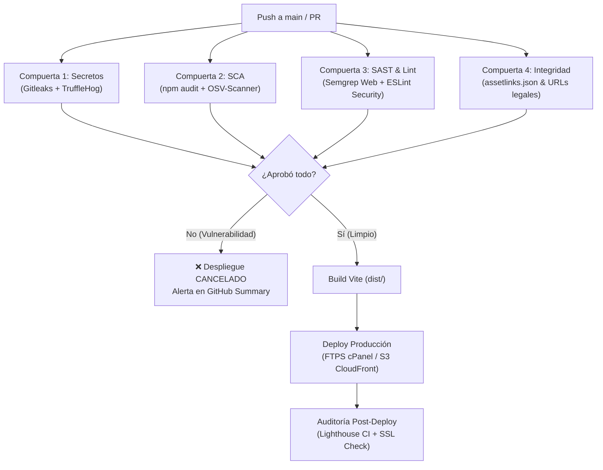

# Estrategia DevSecOps — Landing Page Sensus

Para una **Landing Page** (tanto estática en HTML/CSS/JS como SPA en React/Vite/TypeScript), el enfoque DevSecOps cambia de foco respecto a una app móvil: **no compilas un APK/AAB ni analizas bytecode de Android**, pero sí estás expuesto a **fuga de secretos, XSS, dependencias vulnerables de npm, Clickjacking, caídas de URLs legales exigidas por Google Play y degradación de SEO/rendimiento**.

A continuación se detalla qué herramientas se heredan directamente, cuáles son exclusivas de la web y cuáles se descartan:

---

### 1. Matriz de Aplicabilidad: Móvil vs. Landing Page

| Categoría | Herramienta en Móvil | ¿Aplica en Landing? | Adaptación / Equivalente Web |
|---|---|:---:|---|
| **Secret Scanning** | Gitleaks & TruffleHog | **SÍ (Crítico)** | **100% igual**: Previene fugas de API keys (Firebase, Google Maps, SendGrid/Mailer, tokens cPanel/FTP). |
| **SCA (Dependencias)** | Google OSV-Scanner | **SÍ** | Escanea CVEs en `package.json` y `package-lock.json` contra la base de datos de Google. |
| **SCA (Dependencias)** | Aqua Trivy | **SÍ** | Audita el directorio raíz y dependencias Node/npm en busca de vulnerabilidades y malas configuraciones. |
| **SCA (Nativo)** | OWASP Dependency-Check | **Reemplazable** | En web es más rápido y eficiente usar `npm audit --audit-level=high` o `snyk test`. |
| **SAST (Código)** | Semgrep | **SÍ** | Cambia las reglas: se usan packs `p/javascript`, `p/typescript`, `p/react` y `p/owasp-top-ten` (detecta `dangerouslySetInnerHTML`, Prototype Pollution, Open Redirects). |
| **SAST (Código)** | GitHub CodeQL / SonarCloud | **SÍ** | Analiza vulnerabilidades de lógica web en TypeScript y JavaScript. |
| **SAST (Lenguaje)** | Android Lint, Detekt, Ktlint | **NO** | Exclusivos de Kotlin/Android. En Landing se usan **ESLint** (con `eslint-plugin-security`) y TypeScript compiler (`tsc --noEmit`). |
| **Seguridad Móvil** | MobSFscan | **NO** | Exclusivo de APK/IPA/Android. |
| **Compuerta de Despliegue** | Quality Gate bloqueante | **SÍ** | `needs: [security-gate]`: Si hay secretos o vulnerabilidades críticas, se aborta el upload por FTP/SSH/S3. |
| **Integración App Móvil** | Deep Links / App Links | **SÍ (Crítico)** | Validación sintáctica de `.well-known/assetlinks.json` (crucial para Android App Links y SHA-256). |

---

### 2. Lo que es ÚNICO y OBLIGATORIO para la Landing Page

En una landing vinculada a una app móvil (como `Landing-Sensus`), hay riesgos específicos que un pipeline DevSecOps web debe auditar:

#### A. Integridad de Enlaces Legales (Requisito Google Play)
* **El Problema:** Google Play exige que la URL de **Aviso de Privacidad** (`privacidad.html`) y la de **Eliminación de Cuenta** (`eliminar-cuenta.html`) estén 100% disponibles. Si la landing se rompe o da error 404, **Google suspende la app en la tienda**.
* **DevSecOps:** Un test en el pipeline que compruebe que estas rutas devuelven HTTP 200 y contienen las etiquetas mínimas requeridas.

#### B. Validación y Gobernanza de `assetlinks.json` (Android App Links & SSO)
* **El Problema:** El archivo `https://tudominio.com/.well-known/assetlinks.json` define qué aplicaciones nativas de Android están criptográficamente autorizadas para interactuar con tu dominio web. Si alguien corrompe el JSON, altera el SHA-256 o asigna permisos indebidos, se rompen los enlaces profundos o se pueden exponer credenciales ante apps maliciosas.

##### 1. Los Dos Permisos (`relation`) Autorizados
Al analizar gigantes de la industria como Facebook/Meta, se identifican dos tipos fundamentales de relaciones:
* **A. `"delegate_permission/common.handle_all_urls"` (Deep Linking Universal):**
  Le indica a Android: *"Si el usuario hace clic en una URL de este dominio (como un enlace de recuperación de contraseña o una oferta), ábrelo automáticamente dentro de la app nativa autorizada sin pasar por el navegador"*.
* **B. `"delegate_permission/common.get_login_creds"` (Compartir Contraseñas / SSO):**
  Es el protocolo de **Google Password Manager / Smart Lock**:
  Permite que si el usuario guardó su contraseña en Google Chrome en su computadora o navegador web, su teléfono Android pueda **autocompletar de forma segura esa misma credencial dentro de la app móvil**. Además, permite iniciar sesión con un solo clic entre aplicaciones autorizadas del mismo ecosistema sin necesidad de reescribir contraseñas.

##### 2. Mejores Prácticas de DevSecOps para Digital Asset Links
* **Principio de Menor Privilegio (PoLP):** Solo delegar permisos a `package_name` oficiales y autenticados. Jamás delegar `get_login_creds` a dominios o aplicaciones externas que no pertenezcan al perímetro de confianza de la organización.
* **Integridad Criptográfica de Firmas SHA-256:** Las huellas deben provenir estrictamente del almacén de claves de producción (*Keystore*) o de *Google Play App Signing*. Las claves de desarrollo o depuración (*debug.keystore*) NUNCA deben publicarse en el pipeline de producción.
* **Compuerta Bloqueante en CI/CD:** El pipeline verifica automáticamente mediante scripts en Python que:
  1. El archivo JSON esté bien formado y no contenga sintaxis corrupta.
  2. Cada entrada contenga una relación válida (`handle_all_urls` / `get_login_creds`).
  3. El `target` contenga el espacio de nombres `android_app` y el `package_name` oficial (`sensus.com`).
  4. La lista `sha256_cert_fingerprints` contenga únicamente huellas SHA-256 formadas por 32 pares hexadecimales en mayúsculas.
* **Fail-Closed:** Si la validación falla en cualquier punto, el despliegue a producción se cancela de inmediato para evitar que una configuración inválida llegue al servidor.

#### C. Cabeceras de Seguridad Web (Security Headers)
* Auditoría de cabeceras en `.htaccess` o Nginx:
  - `Content-Security-Policy` (CSP) para evitar inyección de scripts.
  - `X-Frame-Options: DENY` (evita que incrusten tu landing en un iframe malicioso para *Clickjacking*).
  - `Strict-Transport-Security` (HSTS) para forzar HTTPS.

#### D. Rendimiento y SEO (Lighthouse CI)
* A diferencia de una app móvil, el 80% de las visitas a una landing se pierden si tarda más de 2.5 segundos en cargar.
* `lhci` evalúa Core Web Vitals (LCP, CLS, INP) y accesibilidad automáticamente.

---

### 3. Pipeline DevSecOps Recomendado para la Landing (`ci-cd/landing-ci.yml`)

Este flujo condensa las mejores prácticas aplicadas a la landing con compuerta de seguridad bloqueante:

- Gitleaks para escaneo de credenciales y secretos.
- Node.js 22 + npm audit (nivel alto/crítico).
- Google OSV-Scanner para detección de CVEs en dependencias.
- Semgrep SAST con reglas OWASP Top 10 Web, JavaScript y React.
- Validación de sintaxis e integridad para `.well-known/assetlinks.json`.
- Compilación Vite y despliegue condicional por FTPS a cPanel / Neubox.

---

### Conclusión

De todo lo implementado en el móvil:
1. **Conservas el 60%**: Gitleaks, TruffleHog, Semgrep, OSV-Scanner, Trivy, CodeQL y la arquitectura de compuertas condicionales (`needs: [security-gate]`).
2. **Eliminas el 30%**: Android Lint, Detekt, Ktlint, MobSFscan y Keystores de Google Play.
3. **Añades un 10% específico de web**: Validación de `.well-known/assetlinks.json`, auditoría de URLs legales (`privacidad.html`, `eliminar-cuenta.html`) y `npm audit`.
